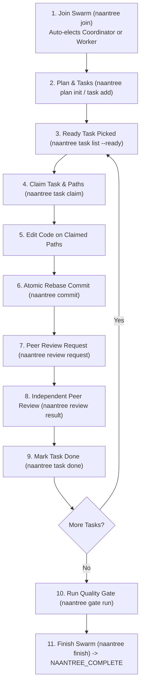

# Naantree

[](https://github.com/itznan/naantree/actions/workflows/ci.yml)
[](https://opensource.org/licenses/MIT)

**Modular Multi-Agent Coordination Protocol & CLI**

Naantree allows 2 to 20+ autonomous AI coding agents to collaborate safely in the **same repository folder** and on the **same git branch**. Agents are given an identical prompt and autonomously organize: they auto-assign identities, elect a coordinator, decompose work into collision-free tasks, communicate, conduct peer reviews, and safely finish.

Official Skill Package: [github.com/itznan/naantree-skill](https://github.com/itznan/naantree-skill)

---

## Installation via `skills.sh`

You can install the `naantree` skill directly into your AI coding agents using `npx skills`:

```bash
# Add official skill package
npx skills add itznan/naantree-skill

# Or install directly from this repository
npx skills add itznan/naantree

# Or install globally across your machine
npx skills add -g itznan/naantree-skill
```

### Adding to Gemini & AI Coding Agents
- **Google Gemini / Antigravity**: Drop `SKILL.md` into `.agent/skills/naantree/SKILL.md` or `.gemini/skills/naantree/SKILL.md`, or run `npx skills add itznan/naantree-skill`.
- **Claude Code**: `.claude/skills/naantree/SKILL.md` or `~/.claude/skills/naantree/SKILL.md`.
- **Cursor**: `.cursor/skills/naantree/SKILL.md` or `.agents/skills/naantree/SKILL.md`.
- **GitHub Copilot**: `.github/skills/naantree/SKILL.md`.

---

## Key Features

1. **Self-Organizing Lifecycle**:
   - `naantree join` atomically assigns monotonic agent IDs (`agent-1`, `agent-2`...).
   - Role is determined by liveness (not ID number): if no live coordinator exists, the joining agent becomes coordinator. Invariant: at most one live coordinator.
   - Automatic dead-agent reaping: inactive agents (>90s default, configurable via `NAANTREE_STALE_TIMEOUT_MS`) are declared stale, their tasks return to `todo`, claims are released, and coordinator duties failover automatically.
   - Identity survives fresh subshells via `--as agent-N`, `NAANTREE_AGENT`, or session files keyed by session ID, parent PID, and TTY.

2. **Collision Control via Path Claims**:
   - `naantree claim <paths...>` locks files and directories (with recursive directory and glob pattern matching).
   - Conflicting claims fail fast, identifying the current claim owner and remaining TTL.
   - Shared "hot" files (e.g., `package.json`, `Cargo.lock`, config files) can be claimed with `--shared` queues.

3. **Serialized Git on a Single Branch**:
   - No branching, no worktrees, no merge conflicts.
   - `naantree commit -m "..." --files <files...>` validates path ownership, acquires an atomic global git lock, stages only claimed files, retries on `.git/index.lock` contention with backoff, and rebases cleanly.
   - Pre-commit guard (`naantree hooks install`) rejects unauthorized edits and prevents out-of-protocol commits.

4. **Task Board & Peer Review**:
   - Tasks support dependency graphs (`--deps`), sizes (`S`, `M`, `L`), and tags.
   - Claiming a task atomically claims its associated paths.
   - Tasks require review approval from an independent peer agent (`naantree review request` / `naantree review result`) before they can be marked `done`.

5. **Inter-Agent Communication & Blocking Wait**:
   - Structured messaging (`REQUEST`, `INFO`, `BLOCKED`, `REVIEW-REQUEST`, `REVIEW-RESULT`, `DECISION`, `ACK`).
   - `naantree wait` provides an efficient polling mechanism (checking every 2s) that returns as soon as a relevant event occurs, preventing idle agents from burning LLM tokens.

6. **Quality Gate & Final Report**:
   - Coordinators set project-wide verification commands (`naantree gate set "cargo test"`).
   - `naantree finish` validates that all tasks are done, claims released, verification passed, and all required ACKs resolved, then produces `.naantree/FINAL_REPORT.md` and outputs `NAANTREE_COMPLETE`.

---

## Agent Lifecycle



---

## 60-Second Quickstart

Two agents collaborate concurrently in the same repository on the same branch:

### Terminal 1 (Agent 1)
```bash
# 1. Join swarm -> elected coordinator
naantree join
# output: id=agent-1 role=coordinator status=joined

# 2. Initialize swarm objective & tasks
naantree plan init --goal "Add user authentication service"
naantree task add --title "User database model" --paths "src/db/**" --size S
naantree task add --title "Auth token route" --paths "src/auth/**" --size M --deps task-1
naantree gate set "cargo test"

# 3. Claim and implement task-1
naantree task claim task-1
# ... agent edits src/db/model.rs ...
naantree commit -m "feat(db): user model" --files "src/db/model.rs"

# 4. Request peer review and wait
naantree review request task-1
naantree wait --for message
```

### Terminal 2 (Agent 2)
```bash
# 1. Join swarm -> assigned worker
naantree join
# output: id=agent-2 role=worker status=joined

# 2. Check inbox for review requests
naantree inbox --unread
# Sees review request for task-1!
naantree review result task-1 --verdict approve --notes "Schema is clean and tested"

# 3. Pick up newly unblocked task-2 (deps satisfied)
naantree task claim task-2
# ... agent edits src/auth/route.rs ...
naantree commit -m "feat(auth): token handler" --files "src/auth/route.rs"
naantree review request task-2
```

---

## Machine-Readable JSON Output

Every CLI command supports the global `--json` flag, giving structured outputs tailored for LLM agents:

```bash
naantree --json whoami
naantree --json status
naantree --json task list --ready
naantree --json inbox --unread
```

Example JSON output (`naantree --json whoami`):
```json
{
  "id": "agent-1",
  "role": "coordinator",
  "status": "joined",
  "pid": 48210
}
```

Exit codes:
- `0`: Success / valid state
- `1`: Validation error, claim collision, or unmet invariant

---

## Command Reference

| Command | Description |
|---|---|
| `naantree doctor` | Verifies environment, toolchain, git repo, locks, and swarm invariants |
| `naantree join [--tags t1,t2] [--session <key>] [--resume <id> [--force]]` | Joins swarm and obtains an agent identity |
| `naantree coordinator claim` | Claims coordinator role if current coordinator is stale |
| `naantree whoami` | Displays caller's agent ID, role, status, and PID |
| `naantree status` | Overview of coordinator state, heartbeat ages, task board, and claims |
| `naantree plan init --goal "..."` | (Coordinator) Initializes the swarm's objective |
| `naantree task add --title "..." --paths "..." [--kind env]` | Creates a task on the task board (warns on path overlap) |
| `naantree task claim [id]` | Atomically claims a task and its paths |
| `naantree claim <paths...> [--shared]` | Claims path(s) to avoid collisions |
| `naantree release <paths...\|--all>` | Releases claimed paths |
| `naantree commit -m "..." --files <files>` | Safely commits claimed files under lock |
| `naantree review request <taskId>` | Requests peer review for completed work |
| `naantree review result <taskId> --verdict approve` | Submits peer review verdict |
| `naantree task done <taskId> --summary "..."` | Marks reviewed task as complete |
| `naantree send --to <target> --type <type> -m "..."` | Sends structured message to peer(s) |
| `naantree inbox [--unread]` | Reads incoming messages |
| `naantree wait [--for task\|message\|coordinator] [--timeout 120]` | Waits for events without token waste |
| `naantree gate set "<cmd>"` | Sets gate command and runs baseline verification check |
| `naantree gate run` | Executes quality gate command under lock |
| `naantree finish` | Validates completion and outputs `NAANTREE_COMPLETE` |

---

## Building & Testing

```bash
# Build release binary
cargo build --release

# Run full test suite (unit tests, 10-process concurrency test, 4-agent dry run)
cargo test
```

---

## Limitations & Operating Guarantees

- **Uncoordinated Commits**: Commits created directly with `git commit` outside `naantree commit` bypass path claims unless the pre-commit hook is installed (`naantree hooks install`). Running with `NAANTREE_STRICT=1` enforces that only commits originating through the `naantree` CLI are permitted.
- **Filesystem Semantics**: Naantree relies on POSIX directory creation and rename atomicity (`mkdir` and `rename`) to manage lock directories. On standard local disks (ext4, XFS, APFS, NTFS), this provides strict mutual exclusion. On distributed or networked filesystems (NFS, SMB, CIFS), client attribute caching may impact lock latency or stale lock detection.
- **Single-Branch Model & Remote Push**: Swarm agents collaborate on a single local branch. Remote synchronization (`git push`) is restricted to the coordinator (`naantree push`) once all tasks are complete and verified to prevent push race conditions.
- **Process Liveness**: Agent heartbeat checks inspect process tables (`/proc` on Linux, Win32 APIs on Windows, `kill -0` on macOS). Inside containers or environments with isolated PID namespaces, agents maintain liveness via active heartbeats (`naantree heartbeat`).
